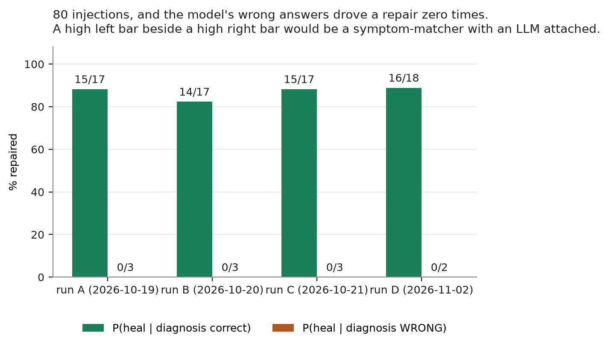
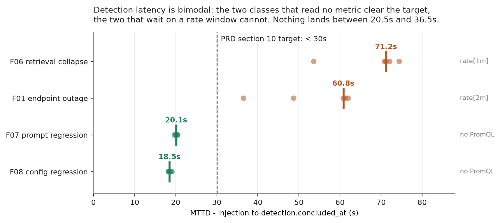
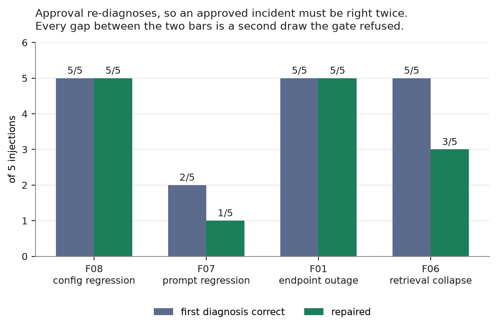
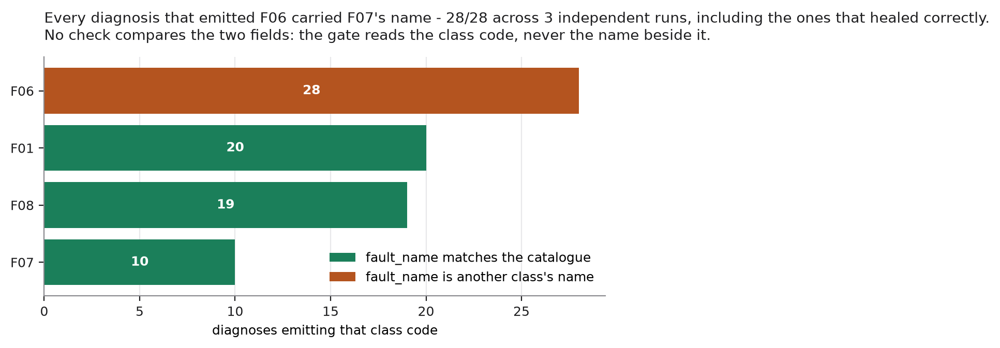

# Kavach — ERI review deck (source)

**This file is the deck's content, not the deck.** It exists so the argument
and the numbers can be reviewed, corrected and version-controlled separately
from the slide rendering. Every figure carries the artifact it came from, and
nothing here is typed from memory — the sources are the four bench artifacts
in `harness/reports/` and the four generated figures.

Target length: **17 slides, ~12 minutes**, leaving time for the live demo.
Speaker notes are what to say, not what to put on the slide.

Status: drafted 2026-10-21, updated 2026-11-02 with run D. **Not yet reviewed
by the team.**

---

## 1 — Title

> # Kavach
> ### An autonomous self-healing control plane that refuses to act when it is unsure
>
> CSE-AI (E) · Group 14 · ERI · AY 2026-27

**Notes.** One sentence only: *"Kavach watches a running RAG application,
detects when it breaks, works out why, and repairs it — and the part we are
actually defending is the word 'refuses'."* Do not explain the architecture
yet.

---

## 2 — The thing that makes this hard

> **An autonomous repair system that is wrong is worse than no system at all.**
>
> A wrong repair:
> - changes production
> - reports success
> - and removes the signal that would have told anyone

**Notes.** This is the whole motivation and it takes 30 seconds. An operator
who gives up leaves the fault visible. A system that "fixes" the wrong thing
leaves the fault *invisible*. Everything in the design follows from that
asymmetry.

---

## 3 — We measured what goes wrong today, and it is not slowness

> | on fault F07 (prompt regression) | diagnosed it | repaired it | **claimed success while still broken** |
> |---|---|---|---|
> | human operator | no | no | **yes** |
> | scripted runbook | **yes, 2/2** | 1 of 2 | **yes** |
> | **Kavach** | yes, 5/5 | 4 of 15 | **no — 0/15** |
>
> *`human-baseline.json`, `runbook-baseline.json`, three bench runs*

**Notes.** The runbook is the sharp case, not the human. **It diagnosed the
fault correctly, applied the correct repair, and still reported a success that
had not happened.** Being right about the cause does not protect you. That is
why verification is a separate step in our loop and not a flag on the repair.

The human pilot is n=3, one operator, and is reported as a pilot — 0/3 correct,
two give-ups, one false recovery. Do not oversell it; the runbook carries the
argument.

---

## 4 — The claim, stated so it can fail

> **Kavach will not execute a repair derived from a wrong diagnosis.**
>
> Falsified by a single counterexample:
> one incident where the model's fault class is wrong
> and a repair runs anyway.
>
> Measured over **60 injections**. Counterexamples found: **0**.

**Notes.** Say explicitly: *"this is stated as a claim that can fail, and here
is exactly what would falsify it."* A reviewer's first instinct is to ask what
would disprove it — answer before they ask. Note that we are **not** claiming a
high repair rate. That is the next slide.

---

## 5 — What we are deliberately not claiming

> - **Not** that it repairs everything — it repairs **73%** *(44/60)*
> - **Not** that the LLM is accurate — it is **85%** *(51/60)*
> - **Not** that it is faster than a runbook — a runbook is **faster** *(37.5s vs 112s median)*
>
> The claim is about the **16 it did not repair** and the **9 it got wrong.**

**Notes.** Giving away the three weakest numbers before anyone asks buys
credibility for the one number we are defending. The runbook comparison is
honest and worth saying aloud: a scripted runbook beats us on speed on the four
faults it was written for, **and would score zero on a fifth.**

---

## 6 — Architecture, in one picture

> `detect → diagnose → VALIDATE → permit → execute → verify → unwind`
>
> - **detect** — deterministic. PromQL, config snapshots, prompt hashes.
> - **diagnose** — the LLM. `qwen2.5:7b-instruct`, local, constrained output.
> - **validate** — does the model agree with the detector? Is this repair legal for this class?
> - **permit** — ten checks, then mode routing.
> - **verify** — an *independent* fast set, not the repair's own opinion.
> - **unwind** — every repair declares its inverse before it runs.

**Notes.** The one structural point: **the LLM sits in the middle, never at the
edges.** It cannot detect and it cannot execute. It proposes, and two
deterministic layers decide. If the model were replaced with a coin flip the
safety result would be unchanged — that is the design goal, and slide 13 is the
evidence it holds.

---

## 7 — The gate: ten checks, then mode routing

> Deny-list **before** allow-list. Verdicts: `ALLOW_AUTO` · `REQUIRE_SANDBOX` · `REQUIRE_APPROVAL` · `DENY`
>
> No action may: delete data · drop a database · scale to zero · run a
> migration · change `EMBED_MODEL` · execute arbitrary code
>
> An `UNKNOWN` diagnosis **never** executes.

**Notes.** Mention that the deny-list is evaluated first on purpose: an
allow-list that is checked first can be widened by adding an entry, a deny-list
checked first cannot be bypassed that way. If asked for the ten: they are in
`ARCHITECTURE.md` §6.1 — don't read them out.

---

## 8 — Results: 80 injections, four runs

> | | run A | run B | run C | run D | target |
> |---|---|---|---|---|---|
> | detection rate | 100% | 100% | 100% | 100% | ≥95% |
> | RCA accuracy | 85% | 85% | 85% | 90% | ≥75% |
> | auto-resolution | 75% | 70% | 75% | 80% | ≥70% |
> | **false healing** | **0%** | **0%** | **0%** | **0%** | ≤5% |
> | MTTR median | 124.4s | 114.9s | 112.0s | 108.8s | <180s |
>
> 4 fault classes × 5 reps × 4 runs. Unattended, `APPROVAL` mode.
> Nothing reset, raised or disabled.
> **Run D is on a host rebuilt from empty after the SSD was formatted.**

**Notes.** RCA accuracy landed on exactly 17/20 three independent times. Say
so, and say that we checked it is not the same file read three times — the
artifacts differ in timestamps, MTTRs and per-class breakdowns.

Four classes, not the nine in the original catalogue. Be ready: F02/F05 dropped
at the week-10 checkpoint, F03's injector could not win a race against the
target's `restart: always` and weakening that was not permitted, F04 retired
(no cache), F09 closed on measurement — it is a ceiling, not a fault. All of
that is in `PRD.md` §6 and the decision records.

---

## 9 — The headline

> # 80 injections.
> # 0 false heals.
> # 0 unclean targets.
> # 11 wrong diagnoses, 0 executed.
>
> Recomputed from the four artifacts, not carried forward.

**Notes.** Pause here. This is the slide the talk exists for. Mention that
false healing is checked by an **independent** fast-set run after the loop
declares `RESOLVED`, not by the loop's own verification — because a bug in the
verification would otherwise hide inside the number meant to detect it.

---

## 10 — The conditional that actually matters

> 
>
> **P(heal | diagnosis correct) = 87%** *(60/69)*
> **P(heal | diagnosis WRONG) = 0%** *(0/11)*
> **P(diagnosis correct | heal) = 100%** *(60/60)*

**Notes.** This is the slide that separates us from a symptom-matcher. A
system that healed at 75% *and* healed 40% of its wrong diagnoses would be
pattern-matching with an LLM bolted on, and the high headline number would be
hiding it. **Report both bars or neither is worth anything.** The right-hand
bar is zero in all four runs, across 80 injections.

If pressed on the denominator: 11 wrong diagnoses is not many, and it bounds
the false-healing rate loosely. What it establishes is that there is no
observed path by which a wrong diagnosis reaches the target — say that, not a
tighter claim.

---

## 11 — MTTD: the aggregate is the least useful true thing about it

> 
>
> | | run B | run C | run D | target |
> |---|---|---|---|---|
> | aggregate median | 28.5s ✅ | 33.0s ❌ | 28.1s ✅ | <30s |
>
> **Same system. Same classes. Same model. Met · missed · met.**

**Notes.** The detectors that read **no metric at all** — F07 compares a prompt
hash, F08 a config snapshot — come in at 18-21s with sub-second spread. The two
that wait on a PromQL `rate()` behind a 15s scrape come in at one window plus
the fast set. Nothing lands in between.

So the median is decided by which side of an empty gap the middle sample falls
on. ADR 0019 predicted the aggregate would be unstable if the class mix
changed; **runs C and D showed it is unstable across repetitions of an
identical run** — met, missed, met on three draws — which is worse than
predicted. If a reviewer quotes run D's 28.1s back as "Kavach meets its MTTD
target", that is a coin landing heads twice in three tosses.

One thing run D adds that is a genuine finding: F01's samples land on a
**ladder** with rungs about 12.2s apart, and run D reproduced three known
rungs to within 0.3s on rebuilt hardware and found a fourth at 72.9s, exactly
one step out. The quantisation is a measurement; the cause is not isolated.

We did **not** move the target. Two of four classes miss `<30s` and are
reported as missing it. If a reviewer presses on this: the detectors are not
slow, the evidence is not yet available when they run.

---

## 12 — Where it loses, and why

> 
>
> **F07 is the class we cannot give a reliable number for:** 0/5, 1/5, 3/5, 1/5.
>
> `approve()` **re-detects and re-diagnoses** rather than replaying a stored plan.
> An approved incident must therefore be diagnosed correctly **twice.**

**Notes.** The re-diagnosis is deliberate — the world may have moved while the
approval dialog was open, and replaying a stored plan would restore a value
that was true when it opened. The cost is double exposure to an unreliable
model.

The honest framing: F07's spread across four runs is sampling variance at n=5,
not improvement. Nothing in the repair path changed. Run C's 3/5 was the
outlier and run D came back to 1/5. **Say "we cannot give a reliable number for
F07" out loud** — it is a better answer than a mean of four noisy fives.

Every other class is at or near ceiling over the four runs: F01 20/20, F08
19/20, F06 16/20. F07 is 5/20 and moves by a factor of three between draws.

If asked for the single best piece of evidence: **F06 rep 2 in run C contains
two different diagnoses of the same fault in one artifact row.** First draw
correct and accepted, second draw refused, nothing executed. Run D produced the
same shape twice on F07 — reps 2 and 5 logged a correct F07 first draw and were
refused with *"LLM says F06"* from the re-diagnosis.

---

## 13 — The model contradicts itself, and nothing noticed

> 
>
> Every diagnosis that emitted F06 carried **F07's name**. 28 of 28, across
> three runs. Every other class: **49 of 49** coherent.
>
> **Predicted before run C, measured during it, re-confirmed by run D on a
> host rebuilt from empty. Exact, three times.**

**Notes.** This is the strongest research result in the project and it is worth
the time.

The model emits a fault *code* and a fault *name*, and `diagnose.txt` gives it
the catalogue to copy the name from. No check in the validator compares the two
fields. Run B found the mismatch by **replaying** stored diagnoses — which
cannot separate a real property of the model from one night's sampling. So
before run C we wrote down the prediction it would have to satisfy, wired
`fault_name` in as a measurement **nothing gates on**, and ran it. 0/8. Then
the machine was reformatted and everything — Docker, Ollama, the weights, the
database, the corpus — was reinstalled from nothing, and run D returned 0/7.
Pooled **0/28**, with 49/49 on the other three classes.

That rebuild rules out the obvious alternative explanations: not a corrupt
model blob (re-pulled), not accumulated store state (empty), not one night's
sampling (three nights, three weeks apart). The repository is the only thing
that carried over — and it is what we are claiming is responsible.

So **F06's 5/5 class accuracy is a weaker result than it reads as** — by its
own prose the model understood all of them as prompt regression, including the
ones that healed correctly.

**We decided not to gate on it — and not because it was expensive.** Enforcing
a coherence check would take F06 from 5/5 to 0/5 and auto-resolution from 80%
to 55%. That cost was never the reason. The reason is that the check catches
**nothing the gate does not already catch**:

| F06 diagnoses, split by whether they were right | gate's outcome | name check adds |
|---|---|---|
| injection was really F07/F08 — 11 of them | **refused, 0 executed** | nothing |
| injection really was F06 — 11 of them | 9 healed | **rejects all 9** |

Its only *unique* effect is to reject correct answers. Because the model's
error isn't "F06 with a bad name" — it's a coherent **F07** diagnosis with one
corrupted field. Name: F07. Proposed repair: F07. Only the class code says F06.

Both gates that catch the real errors read the **repair**, which stays honest.
The name is wrong on every F06 row, healed or not — a constant, not a signal.

> **The safety came from cross-checking the proposed repair, not the stated
> class.** The class code is the least reliable field in the diagnosis, and the
> gate that routes on it is backstopped by two that ignore it.

Defence in depth we measured rather than designed — and it names our thin spot:
a fault whose correct repair is *permitted* for the mis-bound class would leave
only one check standing. (ADR 0021.)

---

## 14 — Why confidence cannot be the gate

> **11 wrong answers in 80 injections. All 11 said F06.**
>
> | | wrong | class named | confidence |
> |---|---|---|---|
> | run A | 3 | F06 ×3 | 0.95 · 0.95 · 0.90 |
> | run B | 3 | F06 ×3 | 0.95 ×3 |
> | run C | 3 | F06 ×3 | 0.95 ×3 |
> | run D | 2 | F06 ×2 | 0.95 ×2 |
>
> Run D's correct answers: 0.80–0.95, **8 of them also at 0.95.**
>
> ⇒ **the two populations do not separate. There is no threshold to pick.**
> All 11 refused. Nothing written.

**Notes.** Be careful to state this precisely, because the sloppy version is
wrong and a reviewer will catch it. We are **not** claiming high confidence
predicts error — 8 correct answers in run D also sit at 0.95.

The claim is stronger and simpler: **the two populations do not separate at
all.** A gate at `>= 0.95` admits both wrong answers. Anything higher admits
nothing. Anything lower admits them plus everything else. There is no cut.

So "why not just threshold on confidence?" — a question this deck should
expect — is proposing a filter that **cannot be configured to work** on this
data, not one that performs worse than ours. That is why `permit()` reads the
deterministic detector and never the model's self-report.

The secondary finding, if there is time: it is always the *same* wrong answer.
`F06` + *"Prompt version regression"* + `rollback_prompt` + `0.95`, eleven times
out of eleven, on two different builds of the machine. One characterised error
mode, not a failure rate.

---

## 15 — The system refuses to go faster

> `permit()` allows **5 incident starts per sliding hour.**
> An approved heal costs **2.**
>
> ⇒ at most **2 approved heals per hour**, then it **halts rather than widening.**
>
> Runs B, C and D spent **445, 443 and 447 of their ~492 minutes waiting**
> under this limit.

**Notes.** Worth saying because it is counter-intuitive and reviewers like it:
the bench takes eight hours to run twenty injections, and **almost all of that
is the safety limiter refusing to let it go faster.** We did not raise it, reset
it or disable it for the benchmark. The run time *is* the evidence — and the
four-minute spread across three independent runs is the same mechanism firing
three times.

Known limitation, state it before being asked: the limiter is in-memory and
resets if the control plane restarts. Persisting it is recorded and not built.

---

## 16 — What Kavach is not

> - **Not** general-purpose — 4 fault classes, one application, one host
> - **Not** a production system — no HA, no multi-tenancy, in-memory limiter
> - **Not** "self-healing RAG" in the usual sense — that term means query-time
>   self-correction *inside* the model; this is **external operational remediation**
> - **Not** autonomous end-to-end — detection is triggered, not continuous
>
> *Every one of these is in the report. None was found by a reviewer first.*

**Notes.** The terminology collision on slide bullet 3 is worth 20 seconds: a
literature search for "self-healing RAG" returns papers about a model
correcting its own retrievals. We are doing something different and we say so
in §1 of the report rather than letting a reviewer think we misread the field.

The last bullet is the one to volunteer rather than defend — Kavach has no
detection tick and no Alertmanager path; incidents start when something starts
them. It is recorded in `RESEARCH_NOTES` §11 and deliberately not built.

---

## 17 — Live demo

> **Four acts, ~6 minutes**
>
> 1. **Inject F01** — endpoint outage. Watch detect → diagnose → gate → approve → heal.
> 2. **Inject F07** — the one it loses. Watch it **escalate instead of guessing.**
> 3. **Show the audit chain** — `make postmortem`, hash-chained, append-only.
> 4. **Hit the blast radius** — try a third heal, watch it refuse.

**Notes.** Act 2 is the demo. Everyone demos the success case; demoing the
failure case and showing the system decline to act is the entire thesis in
90 seconds.

Act 4 only works if the hour window has already been spent — sequence the
acts so it does, or it will quietly allow the third heal and the point is lost.

Pre-flight, every time: `make up`, confirm 8/8 dependencies green, target
`RestartCount=0`, corpus 30 chunks / 2 files. The two failures that have cost
us a session both came from skipping this — a target crash-looping on stale
Docker DNS, and the API running tokenless because `--env-file .env` was dropped.

**Then drive the fast set before opening the console, and do not skip this
because the stack looks healthy.** Measured 2026-11-03 on a stack that had
just restarted: the onboarding page read **"Preflight blocked — 5 of 20"**
while every container was up and healthy. Four of the five were SLO checks
reporting *"query is valid but returned no series"*, because those expressions
are rates over a **5-minute window** and a restarted stack has served nothing
into it. The check is right to fail — an expression matching no series is
exactly how a detection layer goes blind, and that is the condition it exists
to catch — but on a cold stack it is indistinguishable from the real thing.

The subtlety that will cost a demo: **ordinary traffic is not enough.**
`llm_latency_p95` filters `operation="generation"`, and the target records
that label only when it actually generates an answer. Three questions whose
answers were honest refusals — *"I don't know based on the provided
documents"* — produced `query_expansion` and `embedding` samples and no
`generation` at all, so that one check stayed red while the others recovered.
Running the fast set fixed it, because its three cases are known to retrieve
and therefore known to generate.

Sequence, measured: cold stack 5 blocking → after three refused questions,
2 → after the fast set, **1**, and the one that remains is `git repository`,
which always fails when read through the API. The container sees only the
mounted `kavach.yaml`, not the target's working tree, so its git state is
unknown — and the page's own rule is that unknown blocks. **Expect exactly
one red line on the onboarding page during the demo, and know what it says.**

---

## Appendix — likely questions

**"Four classes is not many."** Correct, and the report says so. Each dropped
class has a decision record explaining why, and none was dropped for being hard
to pass. F03's injector could not beat Docker's `restart: always`, and
weakening the target to make our benchmark work was not permitted.

**"Isn't 85% RCA accuracy low?"** Yes, and it is the wrong question. The system
is designed to be safe when the model is wrong — the 11 wrong answers in 80
injections are the condition the design is for, not a defect in it, and 0 of
the 11 reached the target. See slide 10.

**"Run D looks better than run C — did you improve something?"** No, and do not
let this one pass. Nothing in Kavach changed between them. RCA 85%→90%,
auto-resolution 75%→80% and MTTD 33.0s→28.1s are one or two rows out of
twenty moving on faster, rebuilt hardware. We quote all four columns precisely
so nobody quotes the best one.

**"Why does run D matter if nothing changed?"** Because the host was formatted
and rebuilt from empty between C and D. It is the only replication that shares
no system state with the others — and the self-consistency finding survived it
intact, 0/7 on top of 0/21.

**"Why a 7B local model?"** No test may require a cloud API key, so every
result here is reproducible by a reviewer with a laptop. A larger model would
likely improve RCA accuracy and would not change the safety result.

**"Is the target repository modified?"** Only by eleven additions listed in
`PRD.md` §5.2, each with its own decision record. Kavach never pushes, amends
or rewrites history in the target.

**"Did the numbers move after you found the self-contradiction?"** No. It was
wired in as a measurement that nothing gates on, precisely so it could not.
