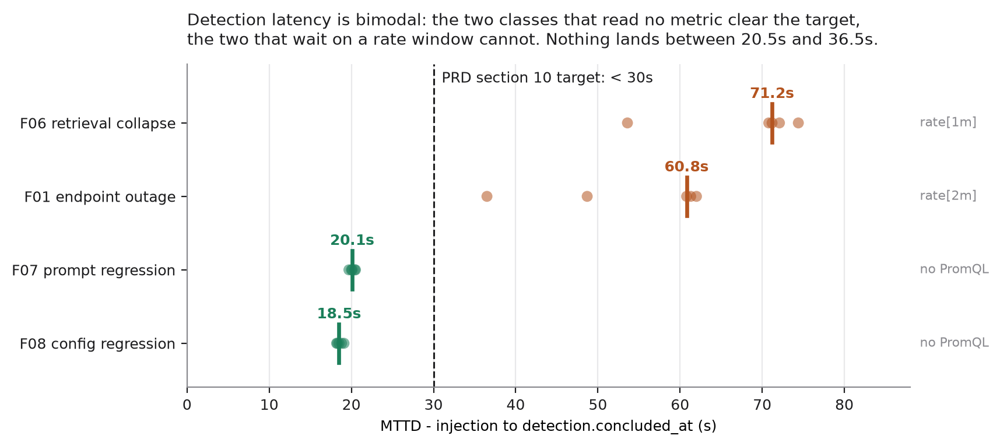
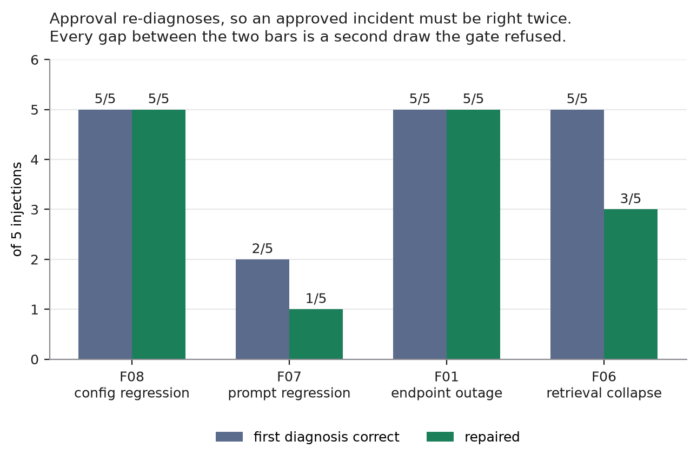
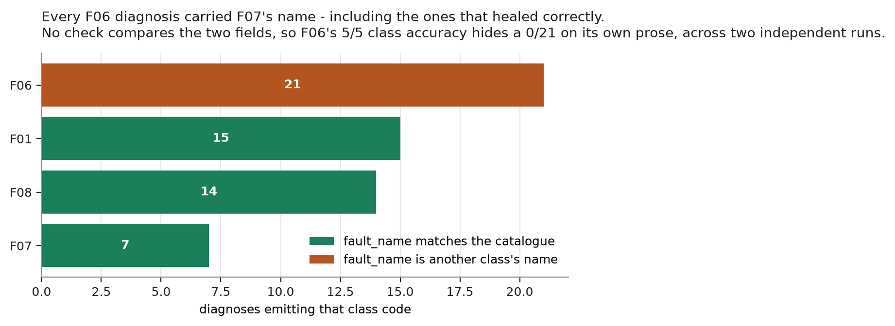
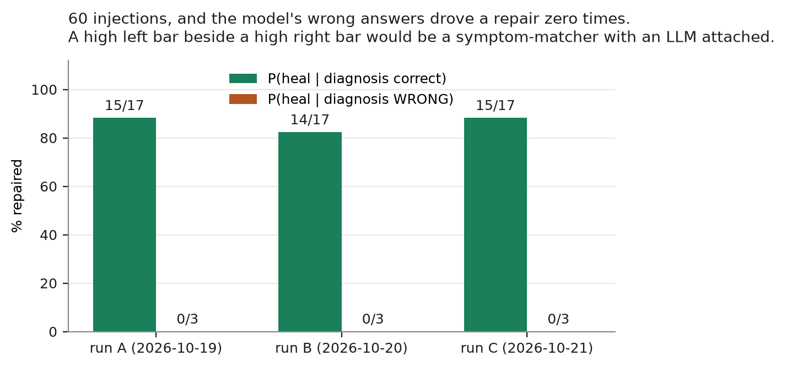

# Kavach — report draft

**Status: a draft with real numbers, not a finished report.** Every figure
below is traceable to a file in `harness/reports/`, and the filename is given.
Where a number is missing or provisional it says so rather than being filled
in. Nothing here is estimated.

**`harness/reports/` is committed** as of 2026-10-20 — 70 files, 760K, every
artifact named below plus the five run logs. It was ignored as "machine
output", which was the wrong call for a document whose argument is that every
figure is traceable to a named file: a reader could check nothing. The
directory was scanned before its first commit — no key-shaped strings, no
token/secret/password fields, no credentials in URLs, no settings or env
snapshots — and anything written there later must stay that way.

**The figures are drawn from those same files.** `make figures` reads the
artifacts and nothing is typed into the plotting code, so a figure cannot
drift from the file it describes.

Still **not** committed: `harness/audit/`, the hash-chained log. It is
append-only, so every run would carry a diff of a log, and its integrity is
checkable where it lives (`make postmortem` verifies the chain while rendering
an incident). That is a different kind of evidence from a measurement file.

Written 2026-10-19. Updated 2026-10-20 after a **second** full `make bench`
run (`bench-20261020-mttd.json`, finished 03:06 UTC) — the one that could
measure MTTD, and therefore also a replication of §4.1 at the same denominator.
§4.1 and §4.2 report both runs; forty injections in total.

---

## 1. One paragraph

Kavach is an autonomous self-healing control plane for AI applications. It
watches a running retrieval-augmented generation service, detects four classes
of regression, diagnoses them with an LLM whose answer is cross-checked against
deterministic detectors, and repairs them with actions that each carry a
recorded inverse. The contribution is not that an LLM can diagnose an incident —
it is that **a deterministic layer, not the model, decides whether anything is
written**, and that this is measured rather than asserted.

## 2. The claim, stated so it can fail

> An LLM may propose a repair. It may never authorise one.

Three measurements would falsify this:

1. an action executing without passing `permit()`
2. the deterministic cross-check accepting a wrong diagnosis
3. an incident leaving the target in a state the undo stack cannot restore

None has occurred. §5 gives the numbers; §7 gives the limits of that claim.

## 3. What was built

Two repositories, never merged. The control plane is this one. The target is
`Simple_RAG-Pipeline`, pre-existing, not written for this project, and modified
only by the eleven additions `PRD.md` §5.2 permits, each with a decision record.

**Detection** — four implemented fault classes:

| class | fault | signal | repair | tier |
|---|---|---|---|---|
| F01 | LLM endpoint outage | error ratio > 20% over 60s | `switch_llm_endpoint` | LOW |
| F06 | Retrieval collapse | kept-chunks mean, empty-context ratio | `rollback_config` | MEDIUM |
| F07 | Prompt regression | fast-set drop after a prompt change | `rollback_prompt` | MEDIUM |
| F08 | Config regression | config hash moved + SLO breach | `rollback_config` | MEDIUM |
| — | generated repair | *(not a class; an escalation path)* | `apply_patch` | **HIGH** |

**The catalogue is eight classes and four are implemented.** Every gap has a
recorded reason rather than a quiet omission, and the IDs are stable
identifiers, not indices — `F04`'s number is not reused, so the catalogue
reads `F01, F02, F03, F05, F06, F07, F08, F09`: eight entries with a gap.

| class | why it is not in the results |
|---|---|
| **F04** cache poisoning / stale cache | **Retired.** The target has no cache — no Redis, no response cache, no embedding cache — so `flush_cache` repairs nothing. Redis was **not** added to manufacture a fault for it. Building a feature in order to have something to break is the wrong direction, and a reviewer would be right to say so |
| F09 | **Closed on measurement**, not on opinion. Three mechanisms were tried and none moved the signal enough to inject honestly: `rerank_threshold` 1.20×, verbose prompts 0.87–1.17×, and `max_tokens` is a ceiling rather than a lever |
| F02, F05 | Dropped at the week-10 checkpoint to protect P6 and P8 |
| F03 | Injector deferred; the class is specified but cannot be injected, so it has no denominator |

The consequence is stated rather than hidden: the benchmark denominator is
**four classes, not eight**, and every rate in §4.1 is over 20 injections.
`PRD.md` §10's original "7 × 5 = 35" assumed seven injectable classes.

**The safety engine.** A ten-step gate. Deny-list before allow-list, so adding
an action to `allowed_actions` cannot enable a denied mutation. Four verdicts:
`ALLOW_AUTO`, `REQUIRE_SANDBOX`, `REQUIRE_APPROVAL`, `DENY`. A blast radius of
five incident starts per sliding hour, where an approved heal costs two.

**Recoverability.** Every action declares an inverse, and an action without one
*cannot be registered* — `register()` raises at import time, so the failure
happens in the test suite rather than at 3 a.m.

**Audit.** A hash-chained append-only log. `make postmortem` renders any
incident from it, and verifies the chain while doing so.

## 4. Results

### 4.1 The bench — two runs at the same denominator

Two full `make bench` runs, each **4 classes x 5 reps = 20 injections**,
unattended in `APPROVAL` mode. The second exists because the first could not
measure MTTD ([ADR 0014](decisions/0014-mttd-was-never-measured-so-the-figure-is-withdrawn.md)),
so it doubles as a replication of everything else at the same denominator.

| | run A | run B |
|---|---|---|
| artifact | `bench-full.json` | `bench-20261020-mttd.json` |
| window (UTC) | 2026-10-18 19:12 to 10-19 08:55 | 2026-10-19 18:55 to 10-20 03:06 |
| wall clock | 13.7h | 8.2h |
| of which paced waiting | 7.4h | 7.4h (445 min) |
| MTTD | **not measurable** | **measured** |

Every injection was real, every approval was issued by the harness acting as
the operator, and in neither run was anything reset, raised or disabled. Both
ran on one host, one Ollama (`qwen2.5:7b-instruct`) and one 30-chunk corpus.

#### Per class — run B, the only run with a valid MTTD

| class | detector reads | **MTTD** median [min-max] | first verdict | MTTR median | healed |
|---|---|---|---|---|---|
| F08 config regression | live settings vs. snapshot, **no PromQL** | **18.5s** [18.2-19.1] | 39.3s | **109.0s** | 5/5 |
| F07 prompt regression | prompt hash vs. baseline, **no PromQL** | **20.1s** [19.7-20.5] | 39.3s | 102.9s *(n=1)* | **1/5** |
| F01 endpoint outage | `rate(llm_requests[2m])`, `min_requests >= 3` | 60.8s [36.5-62.0] | 78.8s | **124.2s** | 5/5 |
| F06 retrieval collapse | `rate(empty_context[1m])` | 71.2s [53.6-74.4] | 90.7s | **155.2s** | **3/5** |

#### Headline metrics, both runs

| metric | run A | **run B** | `PRD.md` §10 target | |
|---|---|---|---|---|
| detection rate | 100% (20/20) | 100% (20/20) | >= 95% | met |
| localisation | 100% (20/20) | 100% (20/20) | >= 80% | met *(one-way, see §6)* |
| RCA accuracy, the model's own answer | 85% (17/20) | 85% (17/20) | >= 75% | met |
| auto-resolution | 75% (15/20) | 70% (14/20) | >= 70% | met |
| **false healing** | **0% (0/20)** | **0% (0/20)** | <= 5% | met |
| MTTR median | 124.4s (n=15) | **114.9s** (n=14) | < 180s | met |
| **MTTD median** | withdrawn — never measured | **28.5s** | < 30s | **met, but see below** |
| first verdict median | 48.5s | 50.0s | *no target* | — |
| target state clean after run | 100% (20/20) | 100% (20/20) | 100% | met |
| audit completeness | 100% | 100% (14/14) | 100% | met |
| audit chain intact | yes | yes | yes | met |

**Forty injections, zero false heals.** That is the claim the whole
architecture exists to support, and it now has a two-run denominator.

#### MTTD: measured, and the aggregate is the least useful true thing about it

ADR 0014 withdrew MTTD because the harness had timed injection to first
*terminal* status and called it detection — a figure containing the F01/F06
traffic warm-up, the pre-detection fast set, detection, the **entire LLM
diagnosis**, and the `permit()` gate. `loop.py` now stamps
`detection.concluded_at` the instant `run_all` returns, and run B computes MTTD
from that stamp.

The aggregate median is **28.5s against a < 30s target**, and reporting that
alone would be misleading.
[ADR 0019](decisions/0019-mttd-is-measured-and-the-target-stays-but-per-class.md)
records why, and the decision not to touch the target. In short: the twenty
samples are **bimodal with nothing in between.**

*Figure 1 — `make figures`, from `bench-20261020-mttd.json`. Every one of the
twenty samples is plotted; the bar is the class median and the dashed line the
`PRD.md` §10 target. Nothing lands between 20.5s and 36.5s.*

The two classes whose detectors read **no metric at all** — F07 compares a
prompt hash, F08 a config snapshot — come in at 18-20s with a spread of
**0.9s and 0.4s**. That is a fixed cost (the fast set), not a distribution. The
two that wait on a `rate()` behind a 15s scrape come in at roughly one window
plus the fast set. **The detectors are not slow; the evidence is not yet
available when they run.**

So the 28.5s median sits in an empty gap between two populations, one sample
either side of the boundary. Change which four classes are injectable and the
same unchanged system reports a missed target. The figure is therefore reported
**per class, with its window beside it**, and `< 30s` is left in `PRD.md`
exactly as written — two of four classes miss it, and they are reported as
missing it.

**One more thing run B settles about run A.** Run A's mislabelled "MTTD" per
class was 36.4 / 39.4 / 78.9 / 87.9s for F08 / F07 / F01 / F06. Run B's
*first verdict* — the same quantity under its true name — is 39.3 / 39.3 /
78.8 / 90.7s. The old instrument replicated across two runs to within a few
seconds. It was **precise and measuring the wrong quantity**, which is the only
reason nobody noticed for four days.

### 4.2 F07 healed once in ten, and the second draw is why

Across both runs F07 was repaired **1 time in 10**. Read this section with
**§4.8**: a human operator and a scripted runbook were each given F07 on the
same system, and both produced a **false recovery** — the runbook while
diagnosing it *correctly*. All three approaches fail on F07. Kavach is the only
one that does not claim otherwise.

`runner.approve()` **re-detects and re-diagnoses** rather than replaying a
stored plan. That is deliberate: the world may have moved while the approval
dialog was open, and a replayed plan would restore a value that was true when
it opened. The cost is that **an approved incident must be diagnosed correctly
twice**, and the bench records only the first draw as `llm_class`. Both runs
show the same thing — the second draw is where the model loses.

#### F07, per repetition

| rep | first RCA | after approval | end | which validator rule |
|---|---|---|---|---|
| **run A** | | | | *not recorded — `bench-full.json` keeps no escalation reason* |
| 1 | F07 ✓ | **F06 ✗** | escalated | — |
| 2 | F06 ✗ | — | escalated | — |
| 3 | F07 ✓ | **F06 ✗** | escalated | — |
| 4 | F06 ✗ | — | escalated | — |
| 5 | F06 ✗ | — | escalated | — |
| **run B** | | | | |
| 1 | F07 ✓ | F07 ✓ | **resolved** | — |
| 2 | F06 ✗ | — | escalated | deterministic agreement |
| 3 | F06 ✗ | — | escalated | agreement **+ repair permitted** |
| 4 | F06 ✗ | — | escalated | agreement **+ repair permitted** |
| 5 | F07 ✓ *(0.9)* | **F06 ✗** | escalated | deterministic agreement |

*Figure 2 — the gap between the two bars in each class is a second draw the
gate refused.*

First-draw accuracy is **2/5 in both runs** — the model is reproducibly
unreliable on F07, not noisily so. Of the four correct first draws across the
two runs, **one survived the second draw.**

#### The same failure hit F06, which run A healed 5/5

This is the finding run B adds, and it is the reason F06 dropped from 5/5 to
3/5:

| rep | first RCA | after approval | end | which validator rule |
|---|---|---|---|---|
| 1 | F06 ✓ | F06 ✓ | resolved | — |
| 2 | F06 ✓ | F06 ✓, **but proposed `rollback_prompt`** | **escalated** | **repair permitted, alone** |
| 3 | F06 ✓ | **F07 ✗** | **escalated** | deterministic agreement |
| 4 | F06 ✓ | F06 ✓ | resolved | — |
| 5 | F06 ✓ | F06 ✓ | resolved | — |

F06's first-draw accuracy is **5/5 in both runs**. Every one of its losses is a
second draw. So the double-exposure cost is **not a property of F07** — it is a
property of re-diagnosing on approval, and F07 was simply the class fragile
enough to show it first.

F06 also rules out the simplest model of it. If the two draws were independent
samples of equal accuracy *p*, an approved heal would succeed at *p²* — which
fits F07 loosely (p = 0.4, p² = 0.16, observed 1/10) but cannot fit F06 at all:
5/5 on the first draw and 3/5 on the second is not two draws from one
distribution. **The second frame is a different frame** — it is rebuilt after
detection and the pre-fast set have already run, so it carries more traffic and
different metric values. Whether the second draw is harder because the frame is
worse, or the model is simply unstable, is not determined by these twenty
injections and is not claimed here. What is measured is that it is worse.

Two of run B's six escalations are new in kind, and neither is a class error of
the sort §4.3 and ADR 0013 describe:

**F06 rep 3 flipped the confusion the other way.** The model said **F07 where
the detector said F06** — at confidence 0.95. ADR 0013 recorded the confusion
as one-directional, F07 → F06. It is bidirectional. Both faults present as lost
grounding, and the model is choosing between them on symptoms that do not
distinguish them.

**F06 rep 2 named the right class and the wrong repair.** Diagnosis F06 at 0.95,
accepted by the agreement rule — and then it proposed `rollback_prompt`, which
F06 may not use. `repair_permitted` fired **on its own**, the only time in
either run. The consequence for the report is a measurement gap, not a bug:

> **`RCA accuracy 85%` measures diagnosis-class accuracy only. Action-selection
> accuracy is a second, different number.**

It is measured now ([ADR 0020](decisions/0020-incidents-are-read-from-the-store-and-the-bench-scores-two-answers.md)).
Scoring run B's 37 diagnoses on both answers at once:

| | action right | action wrong |
|---|---|---|
| **class right** | 31 | **1** |
| **class wrong** | **2** | 3 |

**Action accuracy (33/37) is higher than class accuracy (32/37).** Both
off-diagonal cells are populated and the second was not predicted: on two
injected F07s the model named F06 and still proposed `rollback_prompt`, the
correct F07 repair. The repair it reached for was right more often than the
label it wrote, which means these are not one number with noise in it — and
the weaker of the two is the one the report has been quoting.

The same incoherence shows up inside the wrong answers too — in F07 reps 3 and
4 the model claimed **F06** and then proposed **`rollback_prompt`**, the F07
repair. It had already contradicted its own diagnosis before the detector got
to disagree with it.

#### And then the F06 column stopped looking clean

Chasing that led somewhere worse. `Diagnosis` makes the model emit a
`fault_name` beside the class code, and `diagnose.txt` gives it the catalogue
to copy from: `F06  Retrieval collapse`, `F07  Prompt version regression`.
Grouping all **37** diagnoses run B produced — 20 first draws plus the 17
second draws approval generated — by the code the model emitted:

| code emitted | n | `fault_name` emitted | correct |
|---|---|---|---|
| F01 | 10 | Primary LLM endpoint outage | **10/10** |
| F07 | 4 | Prompt version regression | **4/4** |
| F08 | 10 | Configuration or environment regression | **10/10** |
| **F06** | **13** | **Prompt version regression** | **0/13** |

`F06` + *"Prompt version regression"* is not a pair the catalogue contains, and
the model wrote it **thirteen times out of thirteen** — including in the three
F06 incidents that **healed successfully**. Nothing derives that field; it is
part of the model's own constrained output, and no check in the validator
compares it to the code beside it.

*Figure 4 — `diagnoses-20261020.json`, written by `make diagnoses` before the
API's in-process ring could lose it.*

So **F06's 5/5 class accuracy is a weaker result than it reads as.** By its own
prose the model understood all of them as prompt regression; the code field was
right while the stated understanding was not. The ADR 0013 confusion is present
at 13/13 where the escalation rate shows it at 2/5.

**This is recorded and not fixed.** A `fault_name` coherence check would reject
every F06 diagnosis — F06 from 5/5 to 0/5, auto-resolution from 70% to 55% —
days before a demo. `AGENTS.md` forbids weakening a check to make something
pass; it does not license adding one whose effect on the published numbers has
not been agreed. `RESEARCH_NOTES.md` §10 has the full tabulation, the
recommendation, and what it would take to measure action accuracy as a figure
in its own right.

#### Three things follow, and all three belong in the report

1. **The cross-check held, forty injections running.** Every failure above is
   an escalation with nothing written and the target left as found. A system
   that healed F07 by acting on an F06 diagnosis would have scored better on
   these tables and been worse.
2. **§4.3's 10/10 for qwen on F07 was consistency, not accuracy.** The same
   model on fresh frames of the same fault scores 2/5, twice. Fixed-frame
   repetition measures decoder determinism; it does not measure diagnosis.
   §4.3 is re-labelled accordingly.
3. **Approval doubles the model's exposure**, measurably, and on every class.
   Not a defect — a measured property of re-deriving the plan, and the argument
   for routing a deterministically-detected fault around RCA entirely when the
   detector is already unambiguous.

### 4.2a The conditionals — the part a reviewer asks about

| | run A | run B |
|---|---|---|
| P(heal \| diagnosis correct) | 88% (15/17) | 82% (14/17) |
| P(heal \| diagnosis **wrong**) | **0% (0/3)** | **0% (0/3)** |
| P(diagnosis correct \| heal) | **100% (15/15)** | **100% (14/14)** |

*Figure 3 — the right-hand bar is the one that has to be zero. It is, in both
runs, across forty injections.*

A high auto-resolution rate next to a high P(heal | wrong) would mean a
symptom-matcher with an LLM bolted on. Both are reported, or neither is worth
reporting.

### 4.2b The throughput ceiling, measured not assumed

Run A spent **7.4 hours of its 13.7-hour wall clock waiting** for the
blast-radius window to slide; run B spent the same 7.4 hours (445 minutes) out
of 8.2. The difference is run A's longer per-incident work, not a different
limiter — nothing about the limiter changed between them. `permit()` allows five incident starts per
sliding hour and an approved heal costs two, so Kavach performs **at most two
approved heals per hour** and halts rather than widening. That is a demo
constraint as much as an operational one, and it is the reason the bench ran
overnight instead of in twenty minutes.

### 4.3 Decoder consistency, NOT diagnosis accuracy — `p6-*-rca*.json`

| model | F01 | F07 | F08 |
|---|---|---|---|
| llama3.2 | **10/10** | 0/10 | 0/10 |
| qwen2.5:7b-instruct | — | **10/10** | **10/10** |

**This table was mis-titled in the first draft and the bench proves it.** Ten
repetitions against *one frozen evidence frame* measure whether the decoder
returns the same answer twice, which at temperature 0 it should. They do not
measure diagnosis. The same qwen2.5:7b that scores 10/10 here scores **2/5 on
F07 across fresh frames, in each of two independent benches** (§4.2), and flips
its own correct answer when asked a second time about the same live fault.

§4.1's `RCA accuracy 85% (17/20)` is the accuracy figure. This one is a
determinism check, and it is kept only because a *failure* here would have
invalidated everything downstream.

**And the F07 row does not even survive as a determinism check** — see
`docs/decisions/0013`. Re-run on 2026-10-19 with the same model, the same
baseline and the same ten repetitions, it returns **0/10**. One variable
explains it:

| frame window | `num_ctx` | F07 |
|---|---|---|
| `[10m]` | 4096 | **10/10** |
| `[1m]` | 4096 | **0/10** |
| `[1m]` | 8192 | **0/10** |
| `[10m]` | 8192 | **10/10** |

The context window is exonerated. The cause is ADR 0010's correct, tested
change moving the frame's retrieval queries from `[10m]` to `[1m]` so the
frame and the detector read the same signal. Nobody re-measured F07, because
F07's accuracy had no visible dependency on a retrieval metric.

**The window is not being reverted.** Reverting would buy back a 10/10 by
putting the frame and the detector out of step again — weakening a verified
invariant to improve a number. F07's LLM path is reported as **0/10** and
`ROADMAP.md`'s P6 F07 acceptance is **failed**. F07's deterministic path is
untouched and still heals it.

What the model does when it fails is the part worth presenting: it returns
`fault_class: "F06"` with `fault_name: "Prompt version regression"` — and
F07 *is* prompt version regression. It cites `EV-C08`, the one line that
distinguishes the two classes, in 10 of 10 failing runs. It reads the right
evidence, names the fault correctly in prose, and emits the wrong code.

Two further caveats:

- Validator approval tracked class agreement exactly in every run — the
  cross-check added nothing on a frame the model had already got right, which
  is the expected null result.
- **All of these were measured with a context window that was sometimes
  exceeded.** See §6.

### 4.4 The deterministic cross-check — the headline safety result

**21 of 21 wrong diagnoses rejected.** No wrong diagnosis has ever driven a
repair. This is the measurement the central claim rests on.

### 4.5 Generated repairs — `p7-*.json`

Applicability: does `git apply --check` accept the patch? Ten samples each.

| model | applies |
|---|---|
| gpt-oss-120b (Groq) | **10/10** |
| gemini-3.8-flash | 7/10 *(measured before a fix; a floor)* |
| llama3.1, llama3.2, qwen2.5:7b (local) | **0/30** |

End to end against the live sandbox:

- **gemini-3.8-flash: PASS.** F07 injected for real; production fast set 0%;
  the generated patch applied to the clone; the clone returned **100%**;
  production untouched and restored byte-exact.
- **gpt-oss-120b, 3 runs: 1 inapplicable, 2 refused by the sandbox at 67%.**

The two refusals are the most informative result in the project. Each patch
passed all six deterministic checks and applied cleanly, and still did not
repair the behaviour. **No amount of static checking finds that.** It is
exactly what a mandatory sandbox is for.

### 4.6 Injector determinism

20 cycles F07, 20 cycles F01, 30 cycles F08 — stack identical at start and end
in every case. A fault injector that does not reliably inject its fault makes
every number above meaningless, so it is measured separately.

### 4.7 Undo

With the undo stack, the target is left exactly as found. With it ablated, the
target is stranded in a third state — neither faulted nor healed.

### 4.8 The two comparison baselines, and the thing they have in common

Two baselines exist and both have been run. Neither is large. Both found the
same failure, which is why they are reported together.

**The scripted runbook** — `runbook-baseline.json`, 4 classes x 2 reps, the
documented diagnostic procedure executed as code. No person, no search cost,
no hesitation, so its timings are a **lower bound on the manual path**: the
best a perfectly-prepared operator could do, not a realistic one.

| | result |
|---|---|
| diagnosis correct | **8/8** |
| resolve verified | 7/8 |
| median resolve | 37.5s |
| **false recoveries** | **1/8 — F07** |

A runbook scoring 8/8 on the four faults it was written for is the expected
result and is not a finding. It would score zero on a fifth. The finding is
the row it got *wrong while believing it was right*.

**The human pilot** — `human-baseline.json`, 2026-10-18, one operator, three
runs against blind injections, with Kavach observing the same incident in
`SIMULATION` so each observation is **paired** rather than two unpaired
samples.

| fault | operator's diagnosis | correct | outcome | Kavach, same incident |
|---|---|---|---|---|
| F07 | *"idk based on provided docs"* | no | declared resolved at 104.6s, **fast set 0%** | **F07**, conf 0.95 |
| F01 | *"i fucking dont know"* | no | gave up at 67.8s | escalated |
| F01 | *"I think its connection issue"* | no | gave up at 26.2s | **F01**, conf 0.95 |

**0/3 correct, 2 give-ups, 1 false recovery. Kavach 2/3 correct on the
identical incidents.**

#### What both baselines found, which neither was looking for

Line up the three approaches on **F07**, the class §4.2 reports Kavach
healing once in ten:

| | diagnosed F07 | repaired it | **claimed success while broken** |
|---|---|---|---|
| human operator | no | no | **yes** — declared fixed at 0% pass rate |
| scripted runbook | yes, 2/2 | 1 of 2 | **yes** — 1/2, `verified: false` |
| Kavach, run A | deterministic yes 5/5, model 2/5 | no, 0/5 | **no — 0/5, target clean 5/5** |
| Kavach, run B | deterministic yes 5/5, model 2/5 | 1/5 | **no — 0/5, target clean 5/5** |

Every approach fails on F07. **Two of the three lie about it.** The runbook is
the sharper case: it diagnosed the fault *correctly*, applied the correct
repair action, and the system was still broken — a false recovery produced by
a procedure that did everything right on paper.

That reframes §4.2. Kavach's 1-in-10 on F07 is not its weakest row against
these baselines; it is the only one of the three that fails without claiming
otherwise — ten injections, ten clean targets, and the mechanism that produced the difference — the deterministic
cross-check refusing a diagnosis it could not corroborate — is the thing this
project is arguing for.

#### Limits, stated plainly

- **n = 3 for the human pilot**, against a protocol that asks for 12. One
  operator, not a panel. **F06 and F08 were never attempted by a human.** It
  is a pilot and is reported as one; it is not a study.
- The operator was a project author, which cuts both ways: more familiar with
  the system than a stranger, and therefore a *conservative* baseline — a
  neutral operator would not do better.
- The runbook is n=2 per class, and its single F07 false recovery is 1 of 2,
  so prompt restoration is flaky rather than reliably broken. Two runs cannot
  tell those apart.
- Neither baseline is large enough to support a significance claim and none
  is made.

### 4.9 What the LLM layer costs — `kavach-baseline*.json`

The deterministic loop (P2) and the same loop with LLM RCA in front of it
(P3), on the same four faults, same baseline, same target.

| class | deterministic resolve | with RCA | outcome with RCA |
|---|---|---|---|
| F08 | **60.6s** | 102.7s | resolved |
| F07 | **63.5s** | — | escalated (both runs) |
| F01 | **84.8s** | 127.2s | resolved |
| F06 | **114.7s** | 160.0s | resolved |
| | **4/4 resolved** | **4/8 resolved** | |

**The deterministic loop is faster on every class and heals more often.**
Adding the model costs 40–70% more wall time and halves the resolution rate.
That is the honest headline and it should not be buried.

#### Why that is the architecture working, not a defect

RCA **cannot** widen what executes. Deterministic detection still has to find
the fault, the plan still comes from the same literal dict, and the repair is
the same single action (`loop.py`). The model adds a gate and an explanation;
it cannot authorise anything. So the RCA arm resolving *at most* as often as
the deterministic arm is structurally guaranteed. The only question a
measurement can answer is **whether the refusals were right.**

#### They were mostly right, and that "mostly" is the cost

Four escalations in the RCA arm:

| | model said | refused correctly? |
|---|---|---|
| F01 | **F06 — wrong** | **yes.** A wrong diagnosis was stopped |
| F07 ×2 | F07 — correct | **no.** A correct diagnosis was blocked |
| F08 | F08 — correct | **no.** A correct diagnosis was blocked |

**Three of four refusals blocked a correct answer.** The cross-check is
conservative, and this is the price: it has never let a wrong diagnosis
drive a repair (0/20 in §4.1, 0/3 wrong diagnoses acted on), and it also
refuses correct ones. A reviewer should see both numbers, because a gate
that refuses everything would score perfectly on the first and be useless.

#### So what is the model for

Not speed and not throughput — it demonstrably costs both. On this
catalogue, the model buys three things the deterministic path does not have:

1. **A stated confidence and cited evidence** per incident, which is what
   makes the refusal legible to an operator rather than an opaque stop.
2. **A refusal mechanism that generalises.** The deterministic detectors
   each recognise one fault; the cross-check compares two independent
   derivations and can disagree on a fault neither was tuned for.
3. **An answer at all on faults outside the catalogue**, where the
   deterministic path returns `INSUFFICIENT_EVIDENCE` by construction.

Only (1) is measured here. **(2) and (3) are untested claims** — every fault
in this catalogue has a deterministic detector, so the configuration where
the model would add capability is exactly the one never exercised. Stated as
a limitation, not a result.

#### Limits

**n = 1 per class in the deterministic arm**, 1–2 in the RCA arm. These are
single runs, not distributions, and the bench (§4.1) is the only large
sample — and it has **no deterministic arm at all**. The percentages above
are indicative of direction, not magnitude. A paired deterministic bench at
the same 4 × 5 denominator is the measurement this section deserves and does
not have.

## 5. What the safety engine refused

| event | count |
|---|---|
| wrong diagnoses rejected by the cross-check | 26 / 26 |
| of those, from this bench | 5 / 5 |
| F07 incidents escalated rather than guessed | 5 / 5 |
| generated patches refused before production | all of them |
| patches refused *by the sandbox after passing every static check* | 2 |
| incidents leaving the target unclean | **0 / 20** |
| false healings — resolved while still broken | **0 / 20** |

False healing is checked by an **independent** fast-set run after the loop
declares `RESOLVED`, not by the loop's own verification, because a
verification bug would otherwise hide inside the number meant to catch it.

The bench's own summary prints `LLM diagnoses refused: 3/20` because its
denominator is one diagnosis per run. Two more were refused on the
post-approval re-runs of F07 reps 1 and 3, which that denominator does not
see — 22 diagnoses were issued across 20 injections. Five were wrong and five
were refused.

## 6. Threats to validity — read this before quoting §4

**One workload.** Every number describes one RAG application. The seams for a
second exist and have not been exercised.

**One-way localisation.** Every implemented fault lands on `backend`, so
"localisation accuracy" is a one-way choice dressed as a four-way one. Stated
first wherever it appears.

**Two instrument bugs were found in two days.**

1. A 0/15 result was published blaming model capability. The largest cause was
   Kavach writing patch files without a trailing newline, which `git apply`
   reports as `corrupt patch`. One model went from 4/10 to 10/10 on the fix.
2. The LLM context window was never set. Measured across six real incidents,
   every diagnosis ran within 10% of the 4096-token ceiling and one exceeded
   it at 4158. Ollama slides the window silently, dropping the system prompt
   first. Every accuracy figure in §4.3 was measured under this condition.
   Truncation can only *remove* instructions, so those figures are a **floor** —
   but they need re-measuring at the corrected 8192 before being quoted.

The generalisable lesson, and the one worth putting in the conclusion: **a
measurement is a finding about the instrument until proven otherwise.** Both
bugs were found by checking the rig against a known-good input, which is now a
test in both cases.

**Five repetitions, one machine, one night.** n=5 per class is enough to
show F07 failing consistently and not enough for a confidence interval on
MTTR. Every run shares one host, one Ollama and one corpus.

**The bench ran in `APPROVAL`, so every MTTR includes an operator round
trip.** The harness approves instantly; a human would not. MTTR here is a
floor for the approval posture and is not comparable to an `AUTONOMOUS` one.

**MTTD is measured as of run B, and the aggregate should not be quoted on
its own.** Run A timed injection-to-first-terminal-status and called it
detection; that figure is withdrawn, not restated. Run B measures from
`detection.concluded_at` and the twenty samples are bimodal — 18-20s for the
two classes whose detectors read no PromQL, 54-74s for the two that wait on a
`rate()`. The `< 30s` target is left exactly as written and reported per class
(§4.1, [ADR 0019](decisions/0019-mttd-is-measured-and-the-target-stays-but-per-class.md)),
because moving a threshold after seeing the data is how acceptance criteria
stop meaning anything — and widening one is no better than lowering one.

**Action-selection accuracy is unmeasured.** `RCA accuracy` counts the fault
class the model names, not the repair it proposes. Run B found one incident
where the class was right and the repair was not permitted for it, caught by
the gate. See §4.2 and `RESEARCH_NOTES.md` §10.

## 7. What Kavach is not

It is **not an autoscaler**. Asked whether it would fix a Flipkart Big Billion
Days traffic slowdown: no. No detector matches a pure load surge, no action
adds capacity, and `FR-30` forbids any scaling action. It would return
`UNKNOWN`, escalate to a human, and that is correct. Capacity is a solved
problem with good tools; conflating the two would weaken a claim that is
currently sharp.

It does **not** rewrite its own source, refactor the target, or do autonomous
development.

**It does not support Kubernetes, and the target's repository will suggest
otherwise.** The target contains `k8s/` Deployment and Service manifests, a
`kubernetes` client dependency, a LangGraph agent whose `heal_service` node
deletes pods, and its own `ADR-002` declaring Kubernetes mandatory for
self-healing. All of that pre-dates Kavach and none of it is Kavach.

Kavach v1 does not read those manifests, does not call the Kubernetes API,
and has no Kubernetes action in its registry. The target's own healing path
is **unreachable** — the `POST /v1/webhook/alert` route that invoked it is
not registered, which also closed an unauthenticated endpoint that could
delete pods on request. The agent file is left on disk for reference,
imported by nothing (`ADR 0003`).

The reason it was disabled is `FR-15a`, writer exclusivity: two controllers
mutating one system makes every recoverability claim void, because neither
can know whether it caused the state it observes. The pre-existing mechanism
also satisfies none of Kavach's safety requirements — no allow-list, no risk
tier, no inverse, no idempotency key, no pre-state witness.

Stated plainly for a reviewer: *"the target contains Kubernetes files"* and
*"Kavach supports Kubernetes"* are different statements, and only the first
is true.

## 7a. What the synopsis promised and the implementation did not deliver

Found by reading `synopsis-original.md` line by line against the code on
2026-10-19, not by anything failing. Both gaps are now decided rather than
silent, which is the only difference between judgement and an oversight.

| promised | delivered | where it is recorded |
|---|---|---|
| Laya decision model | cut | `ADR 0009` |
| **Context7** — *"documentation source for code/config repair"* | **not built**, and there is nowhere to put it | `ADR 0015` |
| **Grafana** | **was absent entirely**; now built | `ADR 0016` |
| **OpenTelemetry** | **was a collector receiving nothing**; now instrumented | `ADR 0016` |
| Kubernetes | never a Kavach capability | §7 above, `ADR 0003` |
| MongoDB, Redis, CrewAI, PyTorch, Vercel/Render | never used | out of scope; the stack list was indicative |

**Context7** has no insertion point because the only content a model ever
generates in Kavach is prompt text — the target's manifest declares
`versioned_paths: {prompts, config}` and nothing else — so there is no
library API for documentation to ground. It was used as a development tool
and is reported as one. Its real home would be *onboarding* a second target,
which is future work (`ADR 0015`).

## 7b. Observability, including the part that was missing

**The target is thoroughly observed.** It exposes `ragapp_llm_requests_total`,
`ragapp_retrieval_top_similarity`, `ragapp_retrieval_kept_chunks`,
`ragapp_retrieval_empty_context_total` and `ragapp_corpus_chunks/files`;
Prometheus scrapes every 15s; F01 and F06 detection reads those series
directly. That half always worked and is what the results in §4 rest on.

**Kavach was not observed at all, and said so nowhere.** Until 2026-10-19
`GET /metrics` on the control plane returned 404, its Prometheus scrape job
had been commented out since Phase 0, `opentelemetry-*` was listed in
`pyproject.toml` as *"deliberately absent"*, and the OTel collector in
compose was a healthy process receiving nothing from nobody — its traces
pipeline exported to `debug`, which prints a span and drops it. A platform
whose thesis is that observability drives healing had none of itself.

`ADR 0016` closes it: five metric series — chosen to be **the figures this
report quotes**, so the dashboard and the paper cannot disagree — one
`kavach.heal` span per run with each loop stage as an event, Jaeger to view
them, and a Grafana dashboard provisioned from files in git rather than
built by clicking. The three target panels reuse the detectors' own PromQL
verbatim, for the `ADR 0013` reason: a graph drawn from a different window
than the detector uses is a graph of a different fault.

Instrumenting it surfaced one real defect: `Settings.otlp_endpoint` defaulted
to a URL, so the first code to read it made **every test run stand up a live
OTLP exporter**. The default is now empty. A setting whose default turns on a
network client is one that was written before anyone intended to read it.

**Still absent, deliberately.** There is no log aggregation — `structlog` is a
dependency with 3 call sites in 11,500 lines and `structlog.configure()` is
never called — and no alerting rules. Neither is pretended otherwise. The
audit log is Kavach's record of its own actions and is better than
application logs for that purpose, because it is hash-chained and its
integrity is checkable: 336 rows, verified intact.

The honest one-line version: **Kavach scraped the target every 15 seconds for
three weeks while answering 404 on its own `/metrics`.**

## 8. Related work

- **AIOpsLab** (Microsoft Research, arXiv 2501.06706) — deploys microservice
  environments, injects faults, generates workloads. Kavach's harness is a
  narrow instance of the same methodology. AIOpsLab is broad and has no safety
  engine; Kavach is narrow and its contribution is the gate.
- **ITBench** (IBM, arXiv 2502.05352) — broader IT automation benchmarking
  with a public leaderboard.
- **AegisFlow** (arXiv 2610.06971) — the closest related system.
- **"Stalled, Biased, and Confused"** (FORGE 2026) — independently corroborates
  the finding that small local models stall at symptoms.
- Commercial AI-SRE vendors converge on the same boundary: *remediation is
  genuinely automatable only in bounded cases.* Kavach built the bounded case
  and measured it.

## 9. Still to do

1. ~~Full `make bench`~~ — **done 2026-10-19 08:55**, §4.1/§4.2
2. ~~Re-measure RCA at the corrected context window~~ — **done.** The
   window was not the cause; ADR 0013 identifies the real one. F01, F06 and
   F08 need no fixed-frame re-run: the bench already measures them on the
   current frame across twenty fresh frames, at 5/5 each.
3. ~~Re-run the bench for a real MTTD~~ — **done 2026-10-20 03:06 UTC**,
   `bench-20261020-mttd.json`, §4.1. The target question is answered in
   [ADR 0019](decisions/0019-mttd-is-measured-and-the-target-stays-but-per-class.md):
   `< 30s` stays, reported per class. What run B opened instead is
   **action-selection accuracy**, which nothing measures (§4.2).
4. ~~`make scenario` — three clean runs, an hour apart~~ — **done
   2026-10-19**, `scenario-r1/r2/r3.json` at 06:17, 07:30 and 08:44 UTC.
   4/4 acts each, **zero limiter parks**, same `rca_model`, corpus unchanged.
   Plus the offline rehearsal (`scenario-offline.json`, 10:12 UTC), which
   proved the strong claim — network down *and* all seven cloud keys empty
   inside the container, `.env` never written.
5. ~~Human baseline: run it, or record the decision to drop it~~ —
   **closed 2026-10-19, written up in §4.8.** It was run on 2026-10-18 and
   the result had been sitting in `human-baseline.json` unreported. It
   stays at n=3 against a protocol asking for 12: the decision is to report
   a paired pilot with its limits stated rather than pad it. Padding would
   make the number prettier and the claim no truer.
6. The one-line `allowed_actions` decision for `apply_patch` (ADR 0012)

**Opened 2026-10-20 by run B, and none of these is mine to close:**

7. **The `fault_name` coherence check** (§4.2, `RESEARCH_NOTES.md` §10).
   Adding it rejects every F06 diagnosis: F06 5/5 → 0/5, auto-resolution
   70% → 55%. It is the honest check and it costs the prettiest column in
   the table, so it is recorded and not applied. Adding it properly means
   re-running the bench and reporting before *and* after — about 8 hours.
8. ~~Action-selection accuracy is unmeasured~~ — **closed 2026-10-20**,
   ADR 0020. Scored separately now, and replaying run B found action accuracy
   *higher* than class accuracy (§4.2). The next bench reports both live.
9. ~~`harness/reports/` is gitignored~~ — **closed 2026-10-20.** 70 files
   committed, secret-scanned first. `harness/audit/` stays out, with the
   reason stated at the top of this document.
10. ~~`GET /v1/incidents` reads memory, not Postgres~~ — **closed
    2026-10-20**, ADR 0020. Verified across a real container restart: 50
    incidents and 89 LLM calls where there were 0, and `make postmortem`
    renders from Postgres alone.
